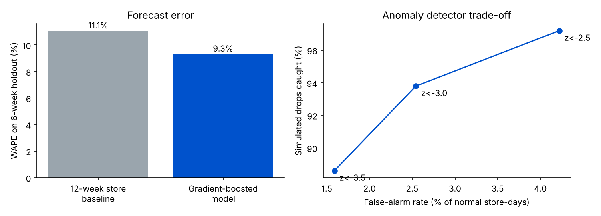

# Retail Store Intelligence: Forecasting, Store Diagnostics and Anomaly Detection

An end-to-end analysis of **1,115 retail stores** and **844,338 open store-days** (Jan 2013 – Jul 2015, Rossmann public dataset) that answers three questions a retail operator asks every week:

1. **Why do some stores sell more than others?** (footfall vs basket size, promotions, competitor openings)
2. **What will each store sell over the next 6 weeks?** (store-day demand forecast vs a strong baseline)
3. **Which store-days look wrong, and how much revenue is at stake?** (residual-based anomaly detection, evaluated on simulated faults)



## Key results

| Area | Finding |
|---|---|
| Sales drivers | **Footfall explains 98%** of the store-to-store variation in average daily sales; basket size explains only 2%. Location and traffic matter far more than ticket. |
| Promotions | Promo days lift sales **+38.8%** (median within the same store and weekday: **+36.5%**). The lift comes from **+21.2% footfall** and **+13.8% ticket size**. |
| Competition | Across **155** competitor openings inside the data window, the store's sales fell a median **3.5%** and footfall **2.7%** (8 weeks after vs 8 weeks before). |
| Forecasting | On a 6-week holdout (40,282 store-days), a gradient-boosted model cuts WAPE from **11.1% to 9.3%** (**−16%**) and RMSPE from 0.157 to 0.140 versus a 12-week same-store, same-weekday, same-promo baseline. |
| Anomalies | Flagging days more than 3 robust standard deviations below forecast catches **94%** of simulated 40% sales drops (**93%** of the lost revenue) while flagging **2.5%** of normal store-days. |

## Method

**Diagnostics.** Sales = footfall × average ticket, so log-sales variance across stores splits exactly into a footfall share and a ticket share. Promo uplift is measured both overall and within store × weekday cells to remove store-mix effects. Competitor impact uses each store's own 8 weeks before and after the competitor's opening month.

**Forecast.** `HistGradientBoostingRegressor` on log sales with calendar features (weekday, day, month, week of year, holidays), promotions, store format and assortment, competitor distance and age, and store-level target encodings (store mean, store × weekday, store × promo, store footfall) computed on training data only. The last 6 weeks are held out; nothing from the holdout is used in training.

**Anomaly detection.** For each store-day: `z = log(actual / forecast) / σ_store`. The per-store spread `σ_store` is measured **out of sample** (a second model trained up to 12 weeks before the end forecasts the 6 weeks before the holdout) using a robust median-absolute-deviation estimate, so a single bad day does not inflate it. To evaluate without labels, 500 random holdout store-days have their sales cut by 40% (a stock-out or staffing gap) and the detector is scored on finding them:

| Threshold | Simulated drops caught | Lost revenue caught | False-alarm rate | Flags |
|---|---|---|---|---|
| z < −2.5 | 97.2% | 96.1% | 4.2% | 2,165 |
| z < −3.0 | 93.8% | 93.1% | 2.5% | 1,481 |
| z < −3.5 | 88.6% | 87.9% | 1.6% | 1,075 |

The threshold is a business choice: a lower one suits a cheap check (an automated stock query), a higher one suits a store-manager call.

## Limitations

- "False alarms" are flags on days with no simulated fault. Some are likely real, unlabelled problems, so the true false-alarm rate is at most the figure shown.
- The competitor analysis is a before/after comparison, not a controlled experiment; seasonality inside the 16-week window is not removed.
- Sales are in euros as recorded; the data is from a German drugstore chain and has no product-level detail.

## Run it

```bash
pip install pandas numpy scikit-learn matplotlib
python run_analysis.py   # writes results/results.json (≈3 minutes)
python make_charts.py    # writes results/summary.png
```

Data: Rossmann Store Sales (Kaggle), `data/train.csv.gz` and `data/store.csv`.
